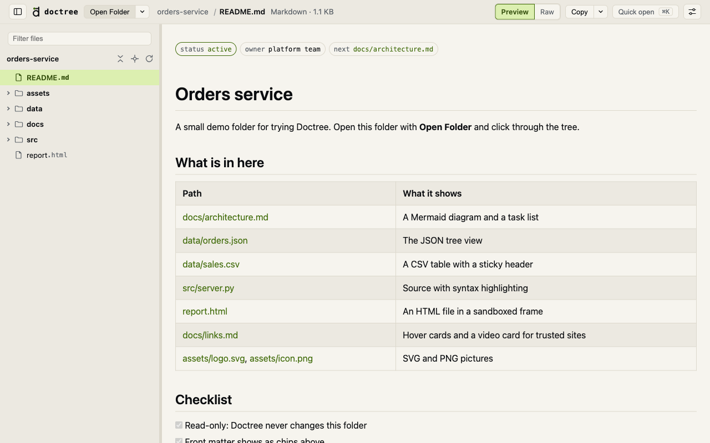
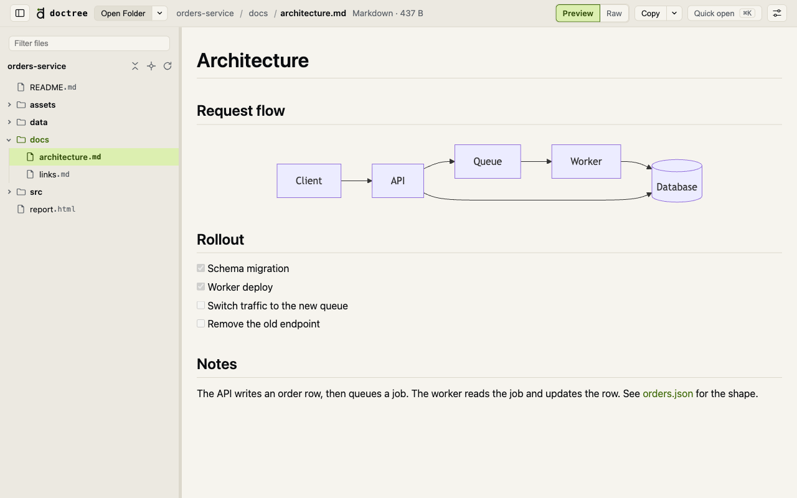
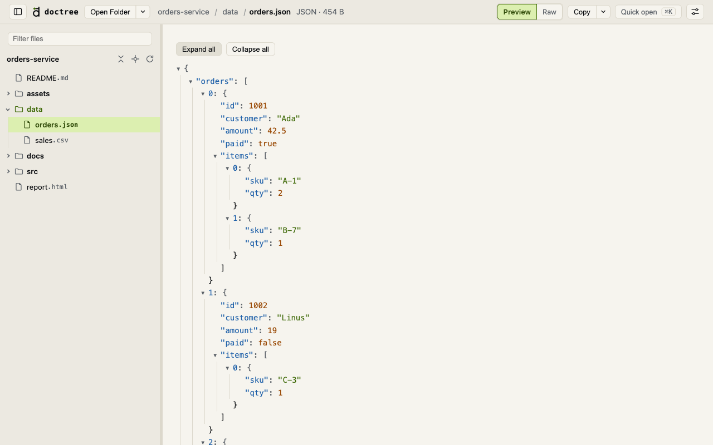
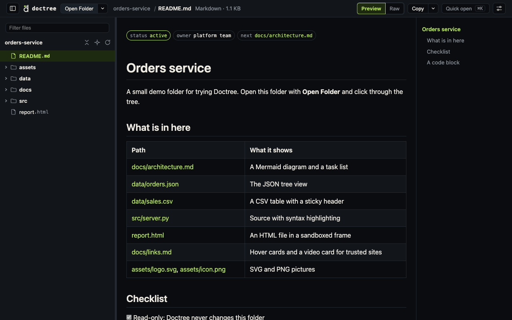
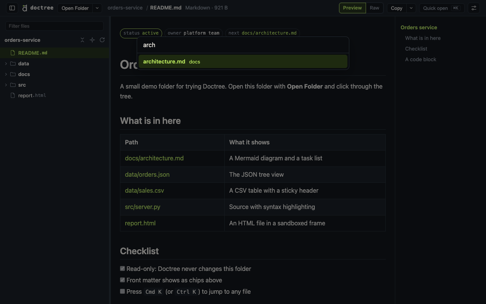
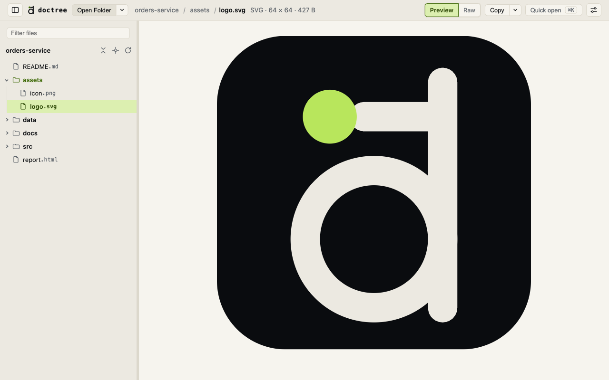
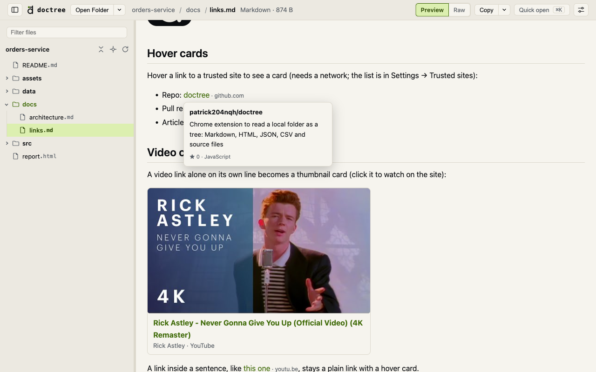

  

<h1 align="center">Doctree</h1>

  Read a local folder in your browser: a file tree on the left, the file on the right. 
  Markdown, HTML, JSON, CSV and source code. Read-only. No account, no tracking.

  
  
  
  
  

  

## Features

- **Folder tree** with every name and extension shown, a filter box, and a breadcrumb with folder lists.
- **Quick open** (`Cmd K` or `Ctrl K`): jump to any file by path, even with the tree hidden.
- **Markdown** with GitHub-style tables and task lists, Mermaid diagrams, relative images, links between files and front matter chips.
- **HTML files** in a sandboxed frame, **JSON** as a foldable tree, **CSV** as a table, **source** with syntax highlighting.
- **Preview | Raw** switch, a Copy menu (text, absolute path, relative path) and an outline panel.
- **Live refresh:** the open file reloads within 2 seconds of a change.
- Light and dark theme, keyboard first.
- **Images:** SVG, PNG, JPEG, GIF and WebP files open as pictures.
- **Trusted sites:** hover a GitHub, Wikipedia or video link for a card; a video link on its own line shows a thumbnail. The site list is editable in Settings.
- **Read-only:** Doctree never edits, uploads or deletes anything.

## Screenshots

| Mermaid diagrams and task lists | JSON tree |
|---|---|
|  |  |
| **Dark theme and outline** | **Quick open** |
|  |  |
| **Images (SVG, PNG and more)** | **Link cards for trusted sites** |
|  |  |

## Install

Or load it unpacked:

1. Clone this repository.
2. Open `chrome://extensions/` and turn on **Developer mode**.
3. Click **Load unpacked** and select this directory.

Works in Chrome 102+, and in other Chromium browsers that support the File System Access API (not tested).

## Quick start

1. Click the toolbar icon. The viewer replaces the current tab; Back returns to the page you were on.
2. Click **Open Folder** and pick a folder. Chrome asks to allow read access.
3. The folder's entry file opens first: `index.md`, else `README.md`, else `task.md`.

No folder to hand? Open [`examples/demo`](examples/demo) from this repository.

## Keyboard shortcuts

| Key | Action |
|---|---|
| `Cmd K` / `Ctrl K` | Quick open: search every file by path. With an empty search it lists the files you opened last |
| `\` | Show or hide the file tree |
| `o` | Show or hide the outline (h1 to h3 of the open file) |
| `w` | Switch reading width: **Full** or **Contained** (860px column) |
| `r` | Switch Preview and Raw |
| `Esc` | Close open lists and menus |

## What it reads

| Type | **Preview** (default) |
|------|----------|
| `.md` | Rendered Markdown (GFM, Mermaid diagrams, relative images, links between files). A leading `key: value` front matter block shows as a row of chips; a value that is a path to a file or folder in the open folder (`next: ../b/draft.md`) is a link |
| `.html` | Rendered in a sandboxed frame: scripts run, but with no access to the extension or the folder. Relative stylesheets, scripts and images load from the folder, and links to other files open in Doctree |
| `.json`, `.jsonl` | A tree: objects and arrays fold, the first two levels start open, and **Expand all** and **Collapse all** open or close the rest. Text that does not parse, or a file over 1 MB or about 20,000 values, shows as indented, highlighted text |
| `.csv`, `.tsv` | A table with a sticky header row. Files over 1 MB show as text |
| `.rb`, `.py`, `.js`, `.ts`, `.sh`, `.rs`, `.go`, `.sql`, `.css`, `.xml`, `.yml`, `.yaml`, `.toml` | Source with syntax highlighting (no switch: this is the text) |
| `.txt`, `.log` | Plain text, exactly as in the file (no switch) |

**Raw** shows the exact text on disk, markup included, so you can select and copy it. The choice lasts for that file until you open another. Text files over 256 KB show the first 256 KB with a **Show all** button. The toolbar shows the file type and size (`Ruby · 4.2 KB`).

Dotfiles, `node_modules` and folders with no supported file are hidden from the tree.

## Using Doctree

**Tree and links.** Click a folder's name to open its entry file and expand it, or its chevron to expand only. The two buttons beside the folder name collapse every folder and jump back to the open file. Links between files work with Back and Forward. A link to a folder (`flows/`) opens that folder's entry file, and `other.md#section` scrolls to the heading. The address bar `#path` is a deep link to the open file.

**Breadcrumb.** The toolbar shows the open file's path. Hover a folder (or focus it and press the down arrow) to list what it holds: the entry file, then subfolders, then files. Hover a subfolder (or press the right arrow) to open its list beside it; the left arrow goes back. Pick a file to open it, or a subfolder to open its first file.

**Settings.** The sliders button opens one panel for every saved preference: theme, reading width, breadcrumb, outline and file tree. Doctree remembers every choice. The theme follows the system until you pick one.

**Recent folders.** The arrow beside **Open Folder** lists the last 8 folders you opened. Pick one to switch to it, or use the cross to forget it. Doctree reopens the most recent one after a Chrome restart, or shows a **Reopen** button if Chrome asks for read access again.

**Copy.** The button copies the file's exact text, whichever view is showing. Its arrow offers the same text, the absolute path, or the relative path. Chrome does not tell an extension where a folder lives on disk, so the first time you copy an absolute path Doctree asks for the folder's location once and remembers it. A code block shows its own **Copy** button on hover.

**Refresh.** Chrome gives an extension no file-change events, so Doctree polls. The open file reloads within 2 seconds of a change. If it is deleted or renamed, the last copy stays on screen with "Removed from disk" beside the name, and it reloads if the file comes back. The tree rescans when you return to the tab, every 15 seconds while the tab is visible, and from the rescan button. A rescan redraws the tree only when a file was added, renamed or removed, and keeps your open folders, scroll position and filter. On a very large folder the interval stretches.

**Single file.** Opening a `.md` file directly in Chrome also renders it. This needs **Allow access to file URLs** on the extension card (Details). The folder tree does not need it.

## Permissions and privacy

`storage` (single-file mode) and `file://*`. No host access to websites. Doctree calls a site only for links to the trusted sites you list in Settings (YouTube, GitHub, Wikipedia and a few more by default): hovering such a link reads that page's public API, and a video link on its own line shows its thumbnail. Remove a site from the list to stop this. Content you open can also call out: Markdown that links to a remote image loads it, and an HTML file can load scripts, styles and images from the web inside its sandboxed frame.

Rendered Markdown is sanitized with DOMPurify and Mermaid runs in strict mode. See [SECURITY.md](./SECURITY.md) and [PRIVACY.md](./PRIVACY.md) (no data collected).

## Develop

`viewer/core.js` holds the pure logic (tree building, search, link resolution, file types, JSON and CSV parsing, front matter, heading ids, recent files, hash paths) with no DOM, so Node can test it: `npm test`. The rest of `viewer/` is plain ES modules with no build step, one per feature:

| File | Owns |
|------|------|
| `viewer.js` | Entry point: single-file or folder mode |
| `state.js` | Open folder and file, shared page elements, saved preferences |
| `dom.js` | Icons, element builders, popover menu behaviour |
| `settings.js` | Settings panel, tree toggle, keyboard shortcuts |
| `folders.js` | Pick, remember and switch folders (IndexedDB); copy path |
| `tree.js` | Sidebar tree, filter, resize, rescan |
| `crumbs.js` | Breadcrumb and its folder lists |
| `palette.js` | Quick open and recent files |
| `outline.js` | Outline panel |
| `reader.js` | Navigation, Markdown, code, table and HTML rendering, reload on change |
| `html-frame.html` | Sandboxed page that runs an opened HTML file (declared under `sandbox` in the manifest) |

Check the DOM code by loading the extension unpacked. `npm run package` builds `doctree.zip` (the files the extension needs, no tests or brand assets) for the Chrome Web Store; the listing text and permission justifications are in [store/listing.md](./store/listing.md).

## Contributing

Issues and pull requests are welcome. Read [CONTRIBUTING.md](./CONTRIBUTING.md) first, and [PRODUCT.md](./PRODUCT.md) for what Doctree is and is not. Changes are listed in [CHANGELOG.md](./CHANGELOG.md).

## License

MIT. See [LICENSE](./LICENSE) and [THIRD_PARTY_NOTICES](./THIRD_PARTY_NOTICES). Started from [aktnk/chrome-markdown-viewer](https://github.com/aktnk/chrome-markdown-viewer) (MIT).