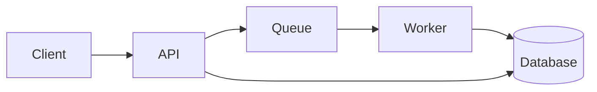

# Architecture

## Request flow

## Rollout

- [x] Schema migration
- [x] Worker deploy
- [ ] Switch traffic to the new queue
- [ ] Remove the old endpoint

## Notes

The API writes an order row, then queues a job. The worker reads the job and updates the row. See [orders.json](../data/orders.json) for the shape.
